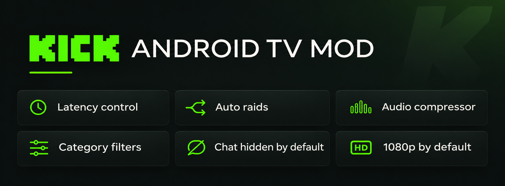
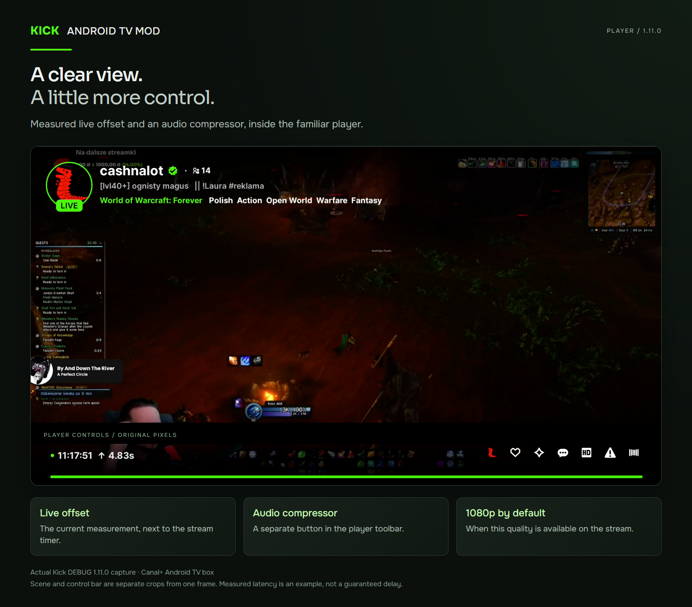
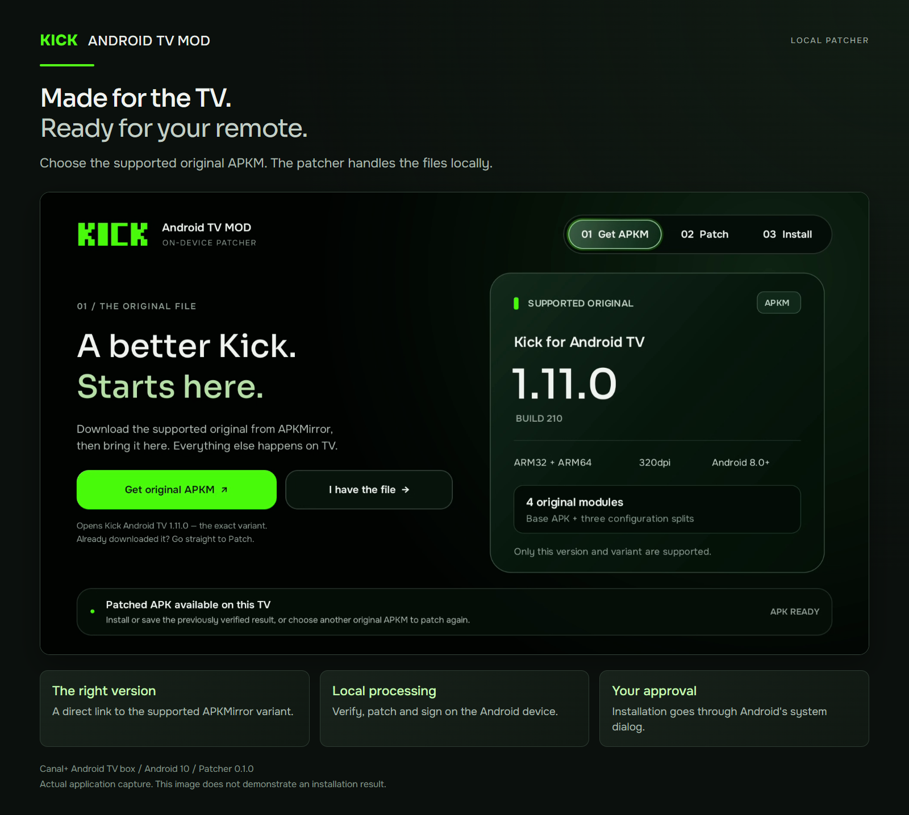
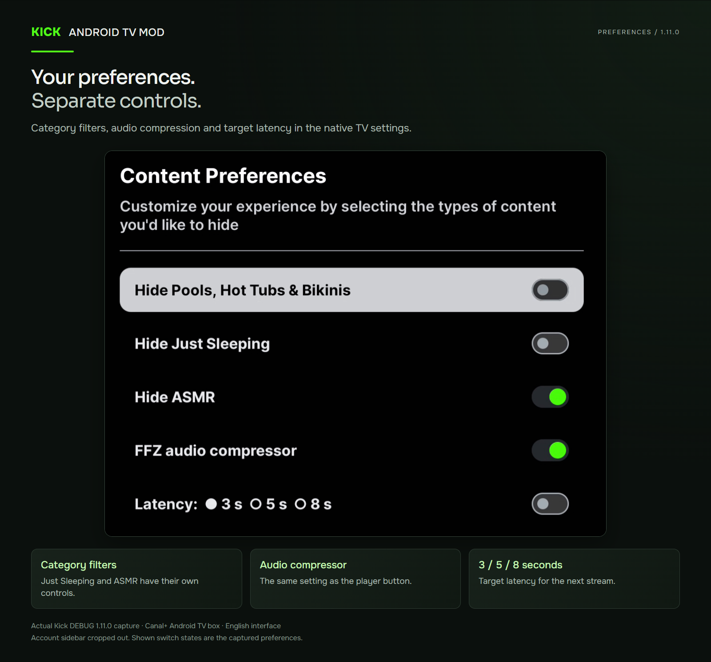

# Kick Android TV MOD



Kick Android TV MOD Patcher adds live latency controls, automatic raid navigation and an audio compressor to the original Kick app. Choose the supported Kick APKM on your TV, then use your remote to patch, sign and install your own copy.

**Patcher 0.1.1 supports Kick Android TV 1.12.0 (build 211).**

[Download the patcher APK](https://github.com/PREMIUMSMART-MOD/kick-android-tv-mod/releases/latest/download/Kick-Android-TV-Patcher.apk) · [Release notes](https://github.com/PREMIUMSMART-MOD/kick-android-tv-mod/releases/latest)



The local patch/sign pipeline, remote navigation and system installation/upgrade flow have passed on a Canal+ Android 10 box. See [the exact test results and limits](docs/TESTING.md).

The patcher does not include or download Kick APKs. Patching runs locally; opening the supported download page uses your TV's web browser.

## Supported input

- Kick: Live Streaming **for Android TV**, **1.12.0 (211)**.
- **arm64-v8a + armeabi-v7a**, **320dpi**, **Android 8.0+** variant.
- [Open the exact APKMirror variant](https://www.apkmirror.com/apk/kick-live-streaming/kick-live-streaming-android-tv/kick-live-streaming-android-tv-1-12-0-release/kick-live-streaming-android-tv-1-12-0-android-apk-download/).
- Base APK and three configuration splits in an `.apkm` file. Each module is verified against its SHA-256 hash before patching. Other versions and variants are rejected.

The **Get original APKM** button opens this version's page. Download the APKM, return to the patcher and select it. Download links and any browser checks are handled by APKMirror; the patcher does not automate them.

## Using the TV app

1. Install the patcher APK on your TV.
2. In **Get APKM**, select **Get original APKM**, or bring the supported original file to the TV yourself.
3. In **Patch**, select **Choose APKM** or **Open Downloads**. Allow read access if requested. Empty system document stubs on Android TV are detected and skipped.
4. Wait for original-file verification, patching, signing and result verification. You can cancel before installation.
5. In **Install**, select **Install on this TV**, allow the patcher as an installation source if requested, and approve Android's installation dialog. **Save a copy** exports through a document provider, or saves to `Download/KickPatcher` on Android 10+ TVs without one.

On TVs without a document picker, you can use an installed file manager's Open/Share action. Direct Download-folder input access is an Android 10 fallback; Android 11+ input requires a document provider or a URI supplied by a file manager. Output export uses MediaStore when a document picker is unavailable. No root or computer is required for the end-user flow.

## Modifications in the 1.12.0 profile

- Target live latency: 3, 5 or 8 seconds in Preferences; measured live offset in the player. Actual stream latency depends on the source and connection.
- Automatic raid navigation through the app's realtime connection.
- Audio compressor with a player button and matching preference.
- Separate Just Sleeping and ASMR category filters.
- Chat hidden by default and 1080p selected by default where available.
- HLS retry and playlist-refresh adjustments.
- Viewer-count and Following/thumbnail refresh improvements.
- Player mature-content confirmation gates skipped; telemetry consent and collection settings disabled by the profile. The Home featured preview can still show its own mature-content warning.

These changes are applied as one tested version-specific profile, not individually selectable patcher switches. Category, audio and latency controls remain inside the resulting app. MultiView keeps its own quality limits and live settings.

## Signing and existing installations

The patcher generates a private signing key in this TV's AndroidKeyStore. It is not uploaded or included in the repository. Later results from the same patcher installation use the same key.

An APK produced with this key **cannot update an existing `com.kick.mobile.mod` signed with another key**. The patcher checks for this conflict and stops installation. It never uninstalls the existing mod or clears its data. The original `com.kick.mobile` is a separate package.

Keep the patcher installed and its data intact. Clearing its data, uninstalling it or resetting the TV loses the signing key; saving the resulting APK does not back up that key. Key import/export is not implemented in this first version.

## Automatic patcher updates

The release app checks GitHub automatically when opened or resumed, at most once every six hours after a successful check. **Updates** also checks immediately. If a newer patcher is available, **Update ready** offers its download and Android's installation approval, directly on the TV. The app checks the download size and SHA-256, verifies the APK signature against the installed patcher's certificate, and rejects different packages and non-increasing version codes.

New Kick versions require a maintainer to prepare and test a matching profile first. When that patcher release is published, the update brings the new profile and exact APKMirror link together. The app does not guess how to patch an unsupported original, automatically download Kick, or overwrite your installed mod. Offline patching continues to work with the bundled supported profile.

Updating the patcher with its matching certificate keeps its data and the TV's output signing key. DEBUG builds stay separate and do not update themselves from the public release feed. No background service runs while the patcher is closed. See [the update and release procedure](docs/UPDATES.md).

## FAQ

**Where do I get the Kick Android TV MOD APK?** Install the [patcher APK](https://github.com/PREMIUMSMART-MOD/kick-android-tv-mod/releases/latest/download/Kick-Android-TV-Patcher.apk) and select **Get original APKM**. Once you have the supported original, the patcher creates the mod APK on your TV.

**Will this replace my current Kick app?** The mod installs alongside the official app. To update an existing mod, the signing key must match. Keep the patcher installed and retain its data to reuse your TV's key.

**Do I need root or a PC?** You can complete the process with your TV remote. Android asks you to approve installation.

## Source and maintainer tools

`app/` is the native Java Android TV application, built against SDK 35, minimum API 26. Internet access is used for patcher update metadata and the patcher APK; original Kick files are processed locally. `apksig` 8.7.2 signs the output with APK Signature Scheme v2 and aligns stored libraries to 16 KB. This alignment does not change the ELF compatibility of upstream libraries.

`maintainer/` contains release-preparation tools, not a PC patcher for end users:

```text
python maintainer/prepare_profile.py --apkm ORIGINAL.apkm --tested-mod LOCALLY_TESTED_MOD.apk --out app/assets/profile
python tests/verify_profile.py --apkm ORIGINAL.apkm --tested-mod LOCALLY_TESTED_MOD.apk
python maintainer/build.py --debug
```

The profile contains per-entry copy instructions, compressed binary deltas and original mod additions. It contains no complete Kick APK or input modules. The decoder operates on files and streams rather than holding the complete APK in memory. Source hashes and reconstructed entry hashes are checked; the signed APK is verified again before it becomes the installable result.

The build uses JDK 11+, Android SDK 35 and build-tools 35.0.0. Override local paths with `--sdk` and `--jdk`. The dependency is fetched from Google's Maven repository if absent and its SHA-256 is pinned. For a signed release, provide your own keystore with `--signing-keystore` and its password through `PATCHER_STORE_PASSWORD`. Keystores are excluded from source control. The default development signing key must not be presented as a release key.

## Preview





Actual application captures, with presentation frames and English captions. Account details are excluded; in-app labels, measured latency and switch states are unchanged. See [screenshot provenance](docs/SCREENSHOTS.md).

## License and attribution

Unofficial project, not affiliated with or endorsed by KICK. Kick's name, artwork and original application belong to their respective owners. Obtain the original app yourself.

Patcher source: Apache License 2.0. Android `apksig`: Apache License 2.0. Audio compression uses the FFZ/Blink-derived implementation and icons with their original attribution; see `THIRD-PARTY-NOTICES.md` and the license files bundled with the profile.
